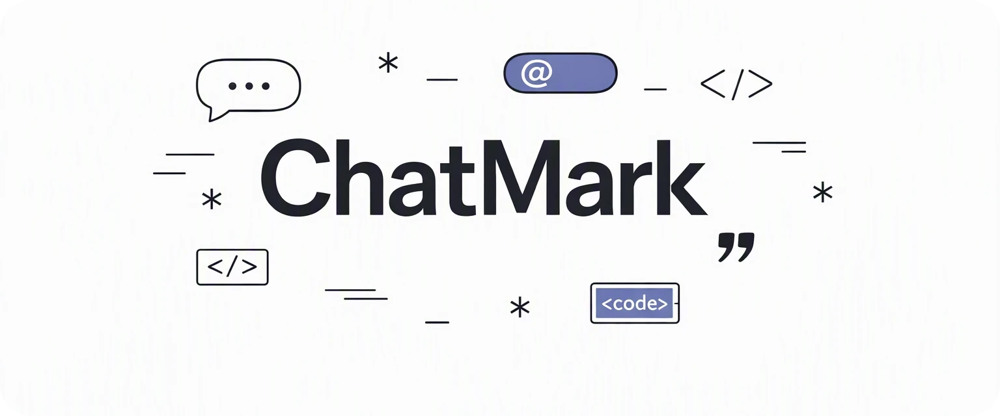

<div align='center'>



</div>

## What is ChatMark?

ChatMark is a chat markup parser and HTML renderer. It parses paragraphs, blockquotes, fenced code blocks, and lists, with inline support for strong, emphasis, strikethrough, code, mentions, autolinks, and line breaks.

## Installation

**Deno:**

```bash
deno add npm:@neabyte/chatmark
```

**npm:**

```bash
npm install @neabyte/chatmark
```

**CDN (jsDelivr/esm.sh):**

```html
<script type="module">
  import Chatmark from 'https://cdn.jsdelivr.net/npm/@neabyte/chatmark/dist/index.mjs'
</script>
```

Or via [esm.sh](https://esm.sh):

```html
<script type="module">
  import Chatmark from 'https://esm.sh/@neabyte/chatmark'
</script>
```

## Usage

### HTML

```ts
import Chatmark from '@neabyte/chatmark'

// Render markup to an HTML string
const html = Chatmark.html('Hello *world* from @neabytelab!')
console.log(html)
// <p>Hello <strong>world</strong> from <span class="chatmark-mention" data-mention="neabytelab">@neabytelab</span>!</p>
```

`Chatmark.html()` parses `source`, escapes HTML special characters (`&`, `<`, `>`, `"`) in text and attributes, and joins the rendered blocks with `\n`.

### Parse

```ts
import Chatmark from '@neabyte/chatmark'

// Parse markup into a document tree
const doc = Chatmark.parse('> Quote\n\n- *bold* and _italic_\n- ~strike~ and `code`')
console.log(doc)
// {
//   type: 'document',
//   children: [
//     {
//       type: 'blockquote',
//       children: [
//         {
//           type: 'paragraph',
//           children: [{ type: 'text', value: 'Quote' }]
//         }
//       ]
//     },
//     {
//       type: 'list',
//       ordered: false,
//       start: 1,
//       items: [
//         {
//           children: [
//             {
//               type: 'paragraph',
//               children: [
//                 { type: 'strong', children: [{ type: 'text', value: 'bold' }] },
//                 { type: 'text', value: ' and ' },
//                 { type: 'emphasis', children: [{ type: 'text', value: 'italic' }] }
//               ]
//             }
//           ]
//         },
//         {
//           children: [
//             {
//               type: 'paragraph',
//               children: [
//                 { type: 'strike', children: [{ type: 'text', value: 'strike' }] },
//                 { type: 'text', value: ' and ' },
//                 { type: 'code', value: 'code' }
//               ]
//             }
//           ]
//         }
//       ]
//     }
//   ]
// }
```

| Element           | Rule                                                                                                                     |
| ----------------- | ------------------------------------------------------------------------------------------------------------------------ |
| Document          | Returns `{ type: 'document', children }` containing the parsed blocks.                                                   |
| Blockquote        | Nests up to a depth of `64`.                                                                                             |
| Ordered list      | Keeps `start` when not `1`.                                                                                              |
| Fenced code block | Takes the first word after the fence as `lang`.                                                                          |
| Mention           | Matches `@` followed by `3` to `35` characters of `a-z`, `0-9`, `.`, or `_` (at most one `.` and one `_`, no outer `.`). |
| Autolink          | Matches valid `http://` and `https://` URLs up to `2048` characters.                                                     |

## API

### `Chatmark.html(source)`

| Parameter | Type     | Description            |
| --------- | -------- | ---------------------- |
| `source`  | `string` | Chat markup to render. |

**Returns:** `string`.

| Element           | Syntax                     | Output                                                                |
| ----------------- | -------------------------- | --------------------------------------------------------------------- |
| Paragraph         | `text`                     | `<p>text</p>`                                                         |
| Blockquote        | `> quote`                  | `<blockquote>\n<p>quote</p>\n</blockquote>`                           |
| Fenced code block | ` ```lang `                | `<pre><code class="chatmark-codeblock-lang">...</code></pre>`         |
| Bullet list       | `- item`                   | `<ul>\n<li>item</li>\n</ul>`                                          |
| Ordered list      | `1. item`                  | `<ol>\n<li>item</li>\n</ol>`                                          |
| Strong            | `*text*` or `**text**`     | `<strong>text</strong>`                                               |
| Emphasis          | `_text_` or `__text__`     | `<em>text</em>`                                                       |
| Strikethrough     | `~text~` or `~~text~~`     | `<del>text</del>`                                                     |
| Inline code       | `` `code` ``               | `<code>code</code>`                                                   |
| Mention           | `@handle`                  | `<span class="chatmark-mention" data-mention="handle">@handle</span>` |
| Autolink          | `https://example.com`      | `<a href="https://example.com">https://example.com</a>`               |
| Hard line break   | Two trailing spaces or `\` | `<br />\n`                                                            |

### `Chatmark.parse(source)`

| Parameter | Type     | Description           |
| --------- | -------- | --------------------- |
| `source`  | `string` | Chat markup to parse. |

**Returns:** `ChatmarkDocument`.

```ts
interface ChatmarkDocument {
  type: 'document'
  children: ChatmarkBlock[]
}

interface ChatmarkParagraph {
  type: 'paragraph'
  children: ChatmarkInline[]
}

interface ChatmarkItem {
  children: ChatmarkParagraph[]
}

type ChatmarkBlock =
  | ChatmarkParagraph
  | {
      type: 'blockquote'
      children: ChatmarkBlock[]
    }
  | {
      type: 'codeblock'
      lang: string
      code: string
    }
  | {
      type: 'list'
      ordered: boolean
      start: number
      items: ChatmarkItem[]
    }

type ChatmarkInline =
  | {
      type: 'text'
      value: string
    }
  | {
      type: 'mention'
      value: string
    }
  | {
      type: 'strong'
      children: ChatmarkInline[]
    }
  | {
      type: 'emphasis'
      children: ChatmarkInline[]
    }
  | {
      type: 'strike'
      children: ChatmarkInline[]
    }
  | {
      type: 'code'
      value: string
    }
  | {
      type: 'autolink'
      href: string
      text: string
    }
  | {
      type: 'break'
    }
```

## Build

```bash
npm run build
```

## Testing

```bash
deno task check
```

```bash
deno task test
```

## License

This project is licensed under the MIT license. See the [LICENSE](LICENSE) file for details.
